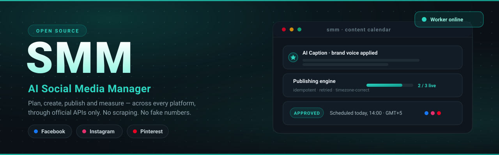
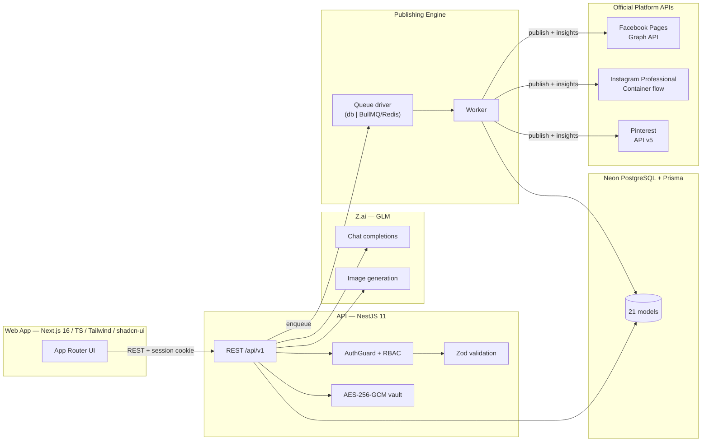

<div align="center">



<br/>

**One brand voice. Every platform. Zero fake numbers.**

SMM is a production-grade, multi-tenant SaaS that plans, creates, schedules and publishes content to **Facebook, Instagram and Pinterest** — through official platform APIs only — with a brand-aware AI engine doing the heavy lifting.

<br/>

[](https://nextjs.org)
[](https://www.typescriptlang.org)
[](https://nestjs.com)
[](https://neon.tech)
[](https://prisma.io)
[](https://bullmq.io)
[](https://z.ai)
[](LICENSE)

&nbsp;


[](https://bun.sh)


<br/>

[What is SMM](#-what-is-smm) · [Features](#-features) · [Architecture](#-architecture) · [API surface](#-api-surface) · [Quickstart](#-quickstart) · [Deployment](#-deployment) · [Roadmap](#-roadmap)

</div>

---

## What is SMM?

Most social tools either fabricate their analytics, automate platforms against their terms of service, or bolt AI on as an afterthought. SMM is built on the opposite set of convictions — enforced in code, not in marketing copy:

> **Official APIs only.** Publishing, engagement and measurement run through the Meta Graph API, the Instagram Platform API and Pinterest API v5. No scraping, no bots, no gray areas. Where an official API does not exist, the feature does not exist — and the UI says so.

> **Honest numbers.** Every metric comes from a real platform response or SMM's own publishing record. If insights are unavailable, the dashboard displays *unavailable* — it never invents reach or impressions.

> **Brand-aware AI.** Captions, hashtags, creatives, weekly plans and inbox replies are all grounded in a per-workspace brand profile. Three operating modes — `MANUAL`, `APPROVAL` and `AUTO` — let teams choose exactly how much control the machine gets.

### Design principles

| Principle | How it shows up in the code |
| --- | --- |
| **Truth over theater** | Demo publishers stamp `[demo]` on every attempt; platform capability limits are read from a single matrix and surfaced in UI, permissions and inbox |
| **Server-side enforcement** | Plan quotas, role permissions and AI credit metering live in the API — the client is never trusted |
| **One source of truth** | Types, zod schemas, role permissions, plan limits and the platform matrix live once in `packages/shared` and are consumed by web, API and worker |
| **Defense in depth** | AES-256-GCM encrypted OAuth tokens, scrypt password hashing, JWT httpOnly sessions, zod-validated input, full audit trail |

## Features

<table>
<tr><td width="220"><b>AI Content Studio</b></td><td>Brand-grounded caption + hashtag generation, AI image generation, media library, and live per-platform previews before anything ships</td></tr>
<tr><td><b>Multi-platform publishing</b></td><td>One post to every connected account via a background engine with idempotency keys, exponential-backoff retries and timezone-correct scheduling</td></tr>
<tr><td><b>Content calendar</b></td><td>Month view of scheduled and approved posts with quick create-and-schedule dialog</td></tr>
<tr><td><b>AI Assistant</b></td><td>Conversational planning grounded in brand + AI settings; one-click weekly plan generator that creates real drafts</td></tr>
<tr><td><b>Unified inbox</b></td><td>Comments and DMs (wherever the platform allows), AI-drafted replies with a review-before-send flow</td></tr>
<tr><td><b>Analytics</b></td><td>Real publishing outcomes, AI credit tracking, CSV export — platform-native insights only when a real account permits</td></tr>
<tr><td><b>Teams</b></td><td>5-tier roles (Owner, Admin, Editor, Approver, Viewer) with 20 fine-grained permissions</td></tr>
<tr><td><b>Billing</b></td><td>Configurable plan matrix (Free / Starter / Professional / Agency) enforced server-side across accounts, members, posts, AI credits and storage</td></tr>
<tr><td><b>Security</b></td><td>AES-256-GCM encrypted OAuth tokens at rest, scrypt hashing, JWT httpOnly sessions, full audit log</td></tr>
<tr><td><b>Multi-tenancy</b></td><td>Workspace-scoped data model — every query and permission check is tenant-aware</td></tr>
</table>

## Architecture



<details>
<summary><b>The publishing pipeline</b> — how a post actually goes live</summary>

1. A post is created and scheduled → every target account receives a `PublishingJob` with the idempotency key `post:{postId}:target:{targetId}`.
2. The worker claims jobs atomically, records each attempt, and retries failures with exponential backoff (30 s → 10 min, max 5 attempts).
3. Posts transition to `PUBLISHED` or `FAILED` **based on real platform responses** — never assumptions.
4. Sandbox/demo publishers are clearly labeled `[demo]` in logs and attempt records, so you always know what actually happened.

</details>

<details>
<summary><b>Platform capability matrix</b> — what official APIs permit, read straight from <code>packages/shared</code></summary>

| Capability | Facebook Pages | Instagram Professional | Pinterest |
| --- | --- | --- | --- |
| Publish text | Text posts | Captions | Pin titles & descriptions |
| Publish media | Image + video | Images, carousels, Reels (container flow) | Image + video Pins |
| Insights | Post & page insights | Account & media insights | Account & pin analytics (business account) |
| Comments | Read & reply | Read & reply | **Not exposed** by API v5 |
| Messaging | Page messaging | **Not available** on the Platform API | **Not available** |

The UI, permission checks and inbox behavior all honor this matrix — SMM never pretends to do something the platform forbids.

</details>

## What's inside

```
smm/
├── src/                    # Next.js 16 web app (App Router, Tailwind 4, shadcn/ui)
├── packages/shared/        # Single source of truth: types, zod schemas,
│                           # role permissions, plan limits, platform matrix
├── mini-services/
│   ├── api/                # NestJS 11 REST API — 14 modules (auth, posts, accounts,
│   │                       #  ai, inbox, analytics, billing, media, brand,
│   │                       #  notifications, audit, workspace, account)
│   └── worker/             # Publishing worker (db + BullMQ/Redis drivers)
├── prisma/                 # 21-model schema (Neon PostgreSQL)
└── .env.example            # Fully annotated environment variables
```

## API surface

Every route is guarded by session auth, workspace-scoped RBAC and zod validation. Swagger docs ship at `/api/v1/docs`.

| Module | Endpoints |
| --- | --- |
| **Auth** | `register` · `login` · `logout` · `session` · `verify-email` · `password` |
| **Accounts** | connect demo accounts · OAuth `start` / `callback` · per-workspace OAuth app config |
| **Posts** | CRUD · `schedule` · `submit` · `approve` · `cancel` · `duplicate` · `publish-now` · `retry` |
| **AI** | `caption` · `image` · `assistant` · `reply-draft` · workspace AI settings |
| **Inbox** | `conversations` · `reply` · `apply-draft` · `resolve` · `reopen` |
| **Analytics** | `summary` · `export.csv` |
| **Billing** | plan read · `upgrade` |
| **Media** | upload · list |
| **Brand** | brand profile read/update |
| **Notifications** | list · `read` · `read-all` |
| **Workspace** | members · invites · role changes |
| **Audit** | immutable activity log |

## Quickstart

```bash
# 1. Install
bun install

# 2. Configure
cp .env.example .env        # fill in POSTGRES_URL, secrets, (optionally) OAuth apps

# 3. Database
bunx prisma generate
bun run db:push

# 4. Run everything
bun run dev                 # web app      → http://localhost:3000
bun run api:dev             # REST API     → http://localhost:3001  (Swagger at /api/v1/docs)
bun run worker:dev          # publishing worker (set QUEUE_DRIVER=db or redis)
```

Create an account from the landing page, connect sandbox demo accounts to explore the full **publish → inbox → analytics** loop, then add your own Meta / Pinterest developer app credentials in **Connected Accounts → Configure OAuth app** for real publishing.

## Teams & roles

| Role | What they can do |
| --- | --- |
| **Owner** | Everything — billing, plan changes, workspace deletion, ownership transfer |
| **Admin** | Manage members, accounts, all content, AI settings and audit log |
| **Editor** | Create, edit, schedule and publish content |
| **Approver** | Review and approve or reject submissions |
| **Viewer** | Read-only access to calendar, inbox and analytics |

## Plans (server-enforced)

| | Free | Starter | Professional | Agency |
| --- | --- | --- | --- | --- |
| Connected accounts | 2 | 5 | 12 | 30 |
| Team members | 1 | 2 | 5 | 15 |
| Posts / month | 20 | 100 | 500 | 5,000 |
| AI credits / month | 30 | 150 | 600 | 2,500 |
| Storage | 100 MB | 1 GB | 5 GB | 25 GB |

Quota errors surface in the UI with an upgrade path; the matrix is defined once in `packages/shared` and consumed by API, worker and UI alike. AI credits are pre-deducted monthly and metered per generation.

## Deployment — one app, one platform

SMM runs as a **full-stack Next.js app**: the REST API (`/api/v1/*`), the AI studio and the publishing engine all live inside the Next.js server. That means the entire backend deploys wherever the frontend does.

| Piece | Target | Notes |
| --- | --- | --- |
| **Everything** | **Vercel** | App + API + publishing engine in one deployment — free tier, no credit card |
| Scheduler trigger | **cron-job.org** (free) | Pings `GET /api/v1/cron/publish?key=CRON_SECRET` every minute to drive the publishing engine |
| Database | **Neon** | Pooled connection string (`POSTGRES_URL`) |
| Media | **Vercel Blob** | `STORAGE_DRIVER=vercel-blob` — public URLs, which Instagram publishing requires |

Standalone deployments (NestJS API + worker on Railway/Render/Oracle) remain available via `mini-services/` + `docker-compose.yml` for teams that prefer split infrastructure.

## Security

- **OAuth tokens at rest** — AES-256-GCM envelope encryption (`v1.iv.tag.data`), key sourced from `APP_ENCRYPTION_KEY`
- **Passwords** — scrypt hashing with per-user salts
- **Sessions** — JWT in httpOnly, sameSite cookies
- **Input** — every endpoint validated with zod schemas shared with the frontend
- **Authorization** — workspace-scoped RBAC checked server-side on every request
- **Audit** — immutable log of security-relevant actions

## Roadmap

- [ ] X (Twitter) and LinkedIn adapters — official APIs, same honesty policy
- [ ] TikTok publishing via Content Posting API
- [ ] Stripe billing with webhook-driven plan sync
- [ ] Queue dashboard for the publishing engine
- [ ] Localization (i18n) for the web app

## License

[MIT](LICENSE) © Faisu Khan

---

<div align="center">

**If SMM saved you hours of content wrangling, a star helps others find it.**

[Report a bug](../../issues) · [Open a PR](../../compare) · [Read the code](../../tree/main)

</div>
