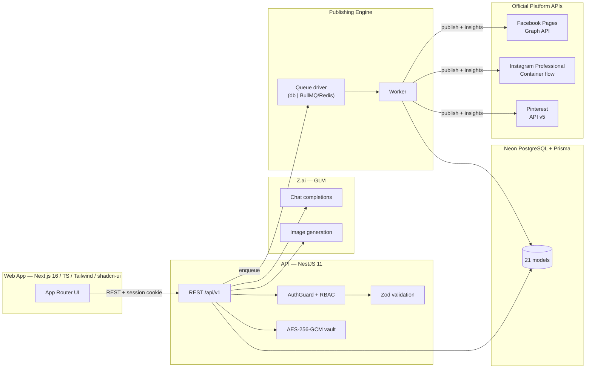

<div align="center">

# SMM

### AI Social Media Manager

**Plan, create, publish and measure content across Facebook, Instagram and Pinterest — on official platform APIs, with a brand-aware AI engine doing the heavy lifting.**

[](https://nextjs.org)
[](https://www.typescriptlang.org)
[](https://nestjs.com)
[](https://neon.tech)
[](https://prisma.io)
[](https://bullmq.io)
[](LICENSE)

</div>

---

## Why SMM

Most social tools either fake their analytics, automate platforms against their terms of service, or bolt AI on as an afterthought. SMM takes the opposite position:

- **Official APIs only.** Publishing, engagement and measurement run through the Meta Graph API, the Instagram Platform API and Pinterest API v5. No scraping, no bots, no gray areas.
- **Honest numbers.** Every metric comes from a real platform response or SMM's own publishing record. If insights are unavailable, the UI says so — it never fabricates reach or impressions.
- **Brand-aware AI.** Captions, hashtags, creatives, weekly plans and inbox replies are grounded in a per-workspace brand profile, with three operating modes: `MANUAL`, `APPROVAL` and `AUTO`.

## Features

| Area | What you get |
| --- | --- |
| AI Content Studio | Brand-grounded caption + hashtag generation, AI image generation, media library, live per-platform previews |
| Multi-platform publishing | One post to every connected account via a background engine with idempotency keys, exponential-backoff retries and timezone-correct scheduling |
| Content calendar | Month view with scheduled/approved posts, quick create-and-schedule dialog |
| AI Assistant | Conversational planning grounded in brand + AI settings, one-click weekly plan generator that creates real drafts |
| Unified inbox | Comments and DMs (where the platform allows), AI-drafted replies with review-before-send flow |
| Analytics | Real publishing outcomes, AI credit tracking, CSV export — platform-native insights only when a real account permits |
| Teams | 5-tier roles (Owner, Admin, Editor, Approver, Viewer) with 20 fine-grained permissions |
| Billing | Configurable plan matrix (Free / Starter / Professional / Agency) enforced server-side: accounts, members, posts, AI credits, storage |
| Security | AES-256-GCM encrypted OAuth tokens at rest, scrypt password hashing, JWT httpOnly sessions, full audit log |
| Multi-tenancy | Workspace-scoped data model; every query and permission check is tenant-aware |

## Architecture



**Publishing pipeline.** Every post target gets a `PublishingJob` with an idempotency key `post:{postId}:target:{targetId}`. The worker claims jobs atomically, records each attempt, retries failures with exponential backoff (30 s → 10 min, max 5 attempts), and marks posts `PUBLISHED` / `FAILED` based on real platform responses. Sandbox demo publishers are clearly labeled `[demo]` in logs and attempt records.

**Platform capability matrix.** SMM is explicit about what each official API can and cannot do (e.g. Instagram has no DM API, Pinterest v5 has no comment posting). The UI, permission checks and inbox behavior all honor this matrix — no pretended capabilities.

## Monorepo Layout

```
smm/
├── src/                    # Next.js 16 web app (App Router, Tailwind 4, shadcn/ui)
├── packages/shared/        # Single source of truth: types, zod schemas,
│                           # role permissions, plan limits, platform matrix
├── mini-services/
│   ├── api/                # NestJS 11 REST API  (modules: auth, posts, accounts,
│   │                       #  ai, inbox, analytics, billing, notifications,
│   │                       #  audit, workspace, brand, account)
│   └── worker/             # Publishing worker (db + BullMQ/Redis drivers)
├── prisma/                 # 21-model schema (Neon PostgreSQL)
└── .env.example            # All required environment variables
```

## Quickstart

```bash
# 1. Install
bun install

# 2. Configure
cp .env.example .env        # fill in POSTGRES_URL, secrets, (optionally) OAuth apps

# 3. Database
bunx prisma generate
bun run db:push

# 4. Run everything
bun run dev                 # web app      → http://localhost:3000
bun run api:dev             # REST API     → http://localhost:3001  (Swagger at /api/v1/docs)
bun run worker:dev          # publishing worker (set QUEUE_DRIVER=db or redis)
```

Create an account from the landing page, connect sandbox demo accounts to explore the full publish → inbox → analytics loop, then add your own Meta / Pinterest developer app credentials in **Connected Accounts → Configure OAuth app** for real publishing.

## Deployment

| Piece | Target | Notes |
| --- | --- | --- |
| Web app | **Vercel** | `next build` — set the same env vars, point API calls at your API host |
| API + Worker | **Railway** | Two services from one repo; run `api:dev`-equivalent start scripts with `QUEUE_DRIVER=redis` and a Railway Redis instance |
| Database | **Neon** | Pooled connection string for the app, direct endpoint for migrations |
| Storage | **S3-compatible** | Set `STORAGE_DRIVER=s3` + bucket credentials for production media |

## Plans (server-enforced)

| | Free | Starter | Professional | Agency |
| --- | --- | --- | --- | --- |
| Connected accounts | 2 | 5 | 12 | 30 |
| Team members | 1 | 2 | 5 | 15 |
| Posts / month | 20 | 100 | 500 | 5,000 |
| AI credits / month | 30 | 150 | 600 | 2,500 |
| Storage | 100 MB | 1 GB | 5 GB | 25 GB |

Quota errors surface in the UI with an upgrade path; the matrix is defined once in `packages/shared` and consumed by API, worker and UI alike.

## Environment Variables

See [.env.example](.env.example) for the complete annotated list — database, auth secret, encryption key, queue driver, storage, per-platform OAuth credentials and Z.ai keys.

## License

[MIT](LICENSE) © Faisu Khan
